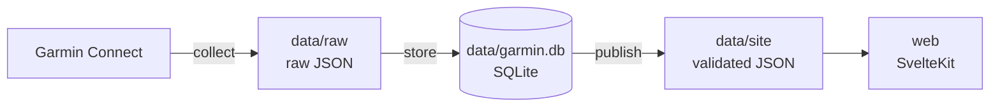

# garmin-insights

A personal running and health dashboard built from your Garmin watch. It downloads your data
from Garmin Connect, keeps everything on your machine and shows it on a local site with direct
answers: how you woke up, whether you are training enough, whether you are getting more
efficient, and how each run and each night went.

It runs on `localhost` only. Nothing leaves your machine except the calls to Garmin itself.

## What is in it

| Page | What it answers |
|---|---|
| **Today** (`/` and `/day/[date]`) | Training Readiness and what weighed in, cards compared with your baseline, the day in detail (HR, stress, Body Battery and steps from midnight to midnight, with sleep and activities), illness alert and the week. Works for any previous day too |
| **Runs** (`/runs`) | Run explorer by any metric, route gallery and table |
| **Run** (`/runs/[id]`) | Map coloured by pace, HR, zone or grade, lanes synced with the map, splits, zones, weather and technique |
| **Progress** (`/progress`) | Efficiency with and without the heat effect, VO2max, race predictions, technique run by run and records |
| **Load** (`/load`) | Whether you are training too little, just right or too much, km per week and how much of the time was easy |
| **Recovery** (`/recovery`) | HRV, resting HR, sleep and Body Battery against your normal range, sleep stages and each night in detail |
| **Maps** (`/maps`) | All runs overlaid by frequency, pace or HR |

## First run

You need:

- Linux, macOS or WSL
- [uv](https://docs.astral.sh/uv/getting-started/installation/) (installs Python by itself)
- [Node.js](https://nodejs.org/) 22 or newer
- A Garmin Connect account with a synced watch

```bash
git clone https://github.com/viniaraujo68/garmin-insights.git
cd garmin-insights
```

Choose how far back to fetch history in `pipeline/src/garmin_insights/config.py`
(`HISTORY_START`). The further back, the longer the first sync takes: about 10 calls per day of
history, with a 1 s pause between them so Garmin does not block you.

After that it is a single command:

```bash
./run.sh
```

The first time, it installs the site dependencies and asks for your e-mail, your password
(hidden) and, if the account has one, the Garmin verification code. The login is saved in
`~/.garminconnect` and the password is not stored. Then it downloads the history, builds the
database and starts the site at http://localhost:5173.

## Day to day

```bash
./run.sh
```

It fetches what changed since the last time (usually 1 to 2 minutes) and starts the site. If
the site is already running, it only updates the data: just reload the page. `Ctrl+C` stops the
site.

The options are at the top of `run.sh`: `PORT`, and `SYNC=false` to start without syncing.

If a login error appears (the Garmin token expires from time to time), log in again:

```bash
cd pipeline && uv run --frozen python -m garmin_insights.login
```

## How it works



1. **collect** downloads each Garmin response into a file under `data/raw/`. It is incremental:
   it only refetches the last `LOOKBACK_DAYS` days (Garmin revises sleep, HRV and load later)
   and fills in whatever is missing. It respects pauses and waits when Garmin answers 429.
2. **store** rebuilds the whole SQLite database from `data/raw/` on every run.
3. **publish** computes the metrics and writes the JSON files the site reads, validated by a
   pydantic contract (an unexpected field or a missing file aborts the publish, and the previous
   site stays).
4. **web** is a SvelteKit app that reads the JSON on every request, so it needs no new build
   after a sync.

| Folder | What is in it |
|---|---|
| `pipeline/src/garmin_insights/collect` | Garmin client with caching, pauses and retries; incremental sync |
| `pipeline/src/garmin_insights/store` | SQLite schema and raw JSON loading |
| `pipeline/src/garmin_insights/calc` | Metrics computed from the database |
| `pipeline/src/garmin_insights/publish` | Contract for the site JSON, writing and verification |
| `web/` | SvelteKit (adapter-node), [plinth](https://github.com/viniaraujo68/plinth), Chart.js e Leaflet |
| `data/` | Outside git: your health and GPS data |
| `docs/DECISIONS.md` | Why each thing was done the way it was |

Garmin access uses the unofficial
[python-garminconnect](https://github.com/cyberjunky/python-garminconnect) library. If Garmin
changes its API, syncing may break until the library is updated.

## Development

```bash
cd pipeline
uv run --frozen pytest -q                       # pipeline tests
uv run --frozen python -m garmin_insights.run   # sync, build the database and publish

cd ../web
npm ci
npm run dev                                     # http://localhost:5173 with hot reload
npm run check                                   # types
npm run lint                                    # Prettier + ESLint
npm run test:e2e                                # Playwright
```

The e2e tests run against your data in `data/site`, so they need a sync first. The first time,
run `npx playwright install chromium-headless-shell`.

The pipeline stages (`STAGES`) are at the top of `pipeline/src/garmin_insights/run.py`; the
rest of the configuration is in `pipeline/src/garmin_insights/config.py`.

When you change the contract (`publish/contract.py`), regenerate the site schema and types; a
test fails if they are out of date:

```bash
cd pipeline && uv run --frozen python -m garmin_insights.publish.schema
cd ../web && npm run types
```

## Privacy

- `data/` is not committed to git: health data and GPS routes stay only on your machine.
- The Garmin login lives in `~/.garminconnect`, outside the project. The password is never saved.
- GPS routes show where you live. The pipeline already detects that area
  (`routes.json` → `privacy`), but the local site shows the full routes. Be careful when
  sharing screenshots of the maps.

## License

[MIT](LICENSE)
