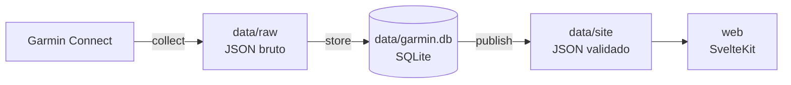

# garmin-insights

Painel pessoal de corrida e saúde a partir do seu relógio Garmin. Ele baixa os seus dados da
Garmin Connect, guarda tudo na sua máquina e mostra num site local com respostas diretas:
como você acordou, se está treinando o suficiente, se está ficando mais eficiente e como foi
cada corrida e cada noite.

Roda só em `localhost`. Nada sai da sua máquina além das chamadas à própria Garmin.

## O que tem

| Tela | O que responde |
|---|---|
| **Hoje** (`/` e `/dia/[data]`) | Prontidão e o que pesou, cards comparados à sua média, o dia em detalhe (FC, estresse, Body Battery e passos da meia-noite à meia-noite, com sono e atividades), alerta de doença e a semana. Funciona para qualquer dia anterior também |
| **Corridas** (`/corridas`) | Explorador de corridas por qualquer métrica, galeria de percursos e tabela |
| **Corrida** (`/corridas/[id]`) | Mapa colorido por pace, FC, zona ou inclinação, curvas sincronizadas com o mapa, splits, zonas, clima e técnica |
| **Evolução** (`/evolucao`) | Eficiência com e sem o efeito do calor, VO2max, previsões de prova, técnica corrida a corrida e recordes |
| **Carga** (`/carga`) | Se você está treinando de menos, na medida ou demais, km por semana e quanto do tempo foi leve |
| **Recuperação** (`/recuperacao`) | VFC, FC de repouso, sono e Body Battery contra a sua faixa normal, fases do sono e cada noite em detalhe |
| **Mapas** (`/mapas`) | Todas as corridas sobrepostas por frequência, pace ou FC |

## Rodando pela primeira vez

Precisa de:

- Linux, macOS ou WSL
- [uv](https://docs.astral.sh/uv/getting-started/installation/) (instala o Python sozinho)
- [Node.js](https://nodejs.org/) 22 ou mais novo
- Uma conta Garmin Connect com um relógio sincronizado

```bash
git clone https://github.com/viniaraujo68/garmin-insights.git
cd garmin-insights
```

Escolha desde quando buscar o histórico em `pipeline/src/garmin_insights/config.py`
(`HISTORY_START`). Quanto mais longe, mais demora a primeira sincronização: são umas 10
chamadas por dia de histórico, com pausa de 1 s entre elas para não ser bloqueado pela Garmin.

Depois é um comando só:

```bash
./run.sh
```

Na primeira vez ele instala as dependências do site, pede o seu e-mail, a senha (escondida) e,
se a conta tiver, o código de verificação da Garmin. O login fica salvo em `~/.garminconnect`
e a senha não é guardada. Em seguida ele baixa o histórico, monta o banco e sobe o site em
http://localhost:5173.

## No dia a dia

```bash
./run.sh
```

Busca o que mudou desde a última vez (normalmente 1 a 2 minutos) e sobe o site. Se o site já
estiver no ar, ele só atualiza os dados: é só recarregar a página. `Ctrl+C` para o site.

As opções ficam no topo do `run.sh`: `PORT`, e `SYNC=false` para subir sem sincronizar.

Se aparecer erro de login (o token da Garmin expira de tempos em tempos), entre de novo:

```bash
cd pipeline && uv run --frozen python -m garmin_insights.login
```

## Como funciona



1. **collect** baixa cada resposta da Garmin para um arquivo em `data/raw/`. É incremental:
   busca de novo só os últimos `LOOKBACK_DAYS` dias (a Garmin revisa sono, VFC e carga depois)
   e completa o que faltar. Respeita pausas e espera quando a Garmin responde 429.
2. **store** reconstrói o banco SQLite inteiro a partir de `data/raw/` a cada execução.
3. **publish** calcula as métricas e escreve os JSON que o site lê, validados por um contrato
   pydantic (campo inesperado ou arquivo faltando derruba a publicação, e o site anterior fica).
4. **web** é um SvelteKit que lê os JSON a cada requisição, então não precisa de build novo
   depois de sincronizar.

| Pasta | O que tem |
|---|---|
| `pipeline/src/garmin_insights/collect` | Cliente da Garmin com cache, pausa e nova tentativa; sync incremental |
| `pipeline/src/garmin_insights/store` | Esquema SQLite e carga do JSON bruto |
| `pipeline/src/garmin_insights/calc` | Métricas calculadas a partir do banco |
| `pipeline/src/garmin_insights/publish` | Contrato dos JSON do site, escrita e verificação |
| `web/` | SvelteKit (adapter-node), [plinth](https://github.com/viniaraujo68/plinth), Chart.js e Leaflet |
| `data/` | Fora do git: seus dados de saúde e GPS |
| `docs/DECISIONS.md` | Por que cada coisa foi feita do jeito que foi |

O acesso à Garmin usa a biblioteca não oficial
[python-garminconnect](https://github.com/cyberjunky/python-garminconnect). Se a Garmin mudar a
API, a sincronização pode quebrar até a biblioteca ser atualizada.

## Desenvolvimento

```bash
cd pipeline
uv run --frozen pytest -q                       # testes do pipeline
uv run --frozen python -m garmin_insights.run   # sincroniza, monta o banco e publica

cd ../web
npm ci
npm run dev                                     # http://localhost:5173 com hot reload
npm run check                                   # tipos
npm run lint                                    # Prettier + ESLint
npm run test:e2e                                # Playwright
```

Os testes e2e rodam contra os seus dados em `data/site`, então precisam de uma sincronização
antes. Na primeira vez, rode `npx playwright install chromium-headless-shell`.

As etapas do pipeline (`STAGES`) ficam no topo de `pipeline/src/garmin_insights/run.py`; o
resto da configuração em `pipeline/src/garmin_insights/config.py`.

Ao mudar o contrato (`publish/contract.py`), regenere o esquema e os tipos do site; um teste
falha se eles estiverem desatualizados:

```bash
cd pipeline && uv run --frozen python -m garmin_insights.publish.schema
cd ../web && npm run types
```

## Privacidade

- `data/` não entra no git: dados de saúde e percursos GPS ficam só na sua máquina.
- O login da Garmin fica em `~/.garminconnect`, fora do projeto. A senha nunca é salva.
- Os percursos GPS mostram onde você mora. O pipeline já detecta essa região
  (`routes.json` → `privacy`), mas o site local mostra os percursos inteiros. Cuidado ao
  compartilhar prints dos mapas.

## Licença

[MIT](LICENSE)
