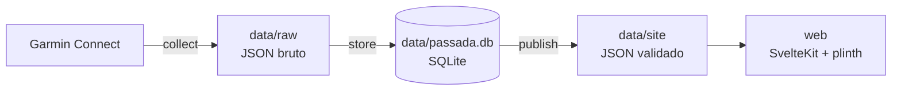

# passada

Painel pessoal de corrida a partir dos dados do relógio Garmin: busca tudo da Garmin Connect,
guarda localmente e mostra em um site com análises de eficiência, carga, recuperação e mapas.



## Rodando

Pré-requisitos: [uv](https://docs.astral.sh/uv/), Node 22+ e um login da Garmin salvo em
`~/.garminconnect` (o mesmo token do MCP do Garmin; para gerar, rode
`uvx --python 3.12 --from git+https://github.com/Taxuspt/garmin_mcp garmin-mcp-auth` num terminal).

```bash
cd pipeline
uv run --frozen pytest -q
uv run --frozen python -m passada.run      # sincroniza, monta o banco e publica

cd ../web
npm ci
npm run dev                                 # http://localhost:5173
```

Checagens do site: `npm run check` (tipos), `npm run lint` (Prettier + ESLint) e
`npm run test:e2e` (Playwright, contra os dados de `data/site`; na primeira vez rode
`npx playwright install chromium-headless-shell`).

As etapas do pipeline (`STAGES`) e a data de referência ficam no topo de
`pipeline/src/passada/run.py`; o resto da configuração em `pipeline/src/passada/config.py`.

O sync é incremental: busca de novo só os últimos `LOOKBACK_DAYS` dias (sono, VFC e carga são
revisados pela Garmin depois) e completa o que faltar. Cada resposta da Garmin vira um arquivo em
`data/raw/`; o banco e o site são reconstruídos a partir dele a cada execução.

## Telas

| Rota | O que responde |
|---|---|
| `/` Hoje | Prontidão e o que pesou, cards comparados à sua média, alerta de doença, semana e alertas de carga |
| `/corridas` | Explorador de corridas por qualquer métrica, galeria de percursos e tabela |
| `/corridas/[id]` | Mapa colorido por pace, FC, zona ou inclinação, curvas sincronizadas, splits, zonas, clima e técnica |
| `/evolucao` | Eficiência com e sem o calor, VO2max, previsões de prova, técnica no mesmo ritmo, recordes e idade fitness |
| `/carga` | Carga aguda na faixa ótima, condicionamento/fadiga/frescor, 80/20, minutos por esporte, foco, monotonia e calendário |
| `/recuperacao` | Tendências com a sua faixa normal, fases e regularidade do sono, hipnograma por noite e mês num relance |
| `/mapas` | Todas as corridas sobrepostas por frequência, pace ou FC |
| `/esportes` | Futebol (piques e posições), academia (mapa muscular e 1RM) e quilometragem dos tênis |
| `/guia` | O que cada métrica significa e as faixas de referência |

## Pastas

| Pasta | O que tem |
|---|---|
| `pipeline/src/passada/collect` | Cliente da Garmin com cache, pausa e nova tentativa em 429; sync incremental |
| `pipeline/src/passada/store` | Esquema SQLite e carga do JSON bruto |
| `pipeline/src/passada/calc` | Métricas próprias calculadas a partir do banco |
| `pipeline/src/passada/publish` | Contrato pydantic dos JSON do site, escrita e verificação |
| `web/` | SvelteKit (adapter-node) + plinth + Chart.js + Leaflet |
| `data/` | Fora do git: dados de saúde e GPS |

## Contrato entre pipeline e site

Os JSON publicados seguem os modelos de `publish/contract.py` (campos extras são rejeitados e
cada arquivo é relido antes de substituir o site). O esquema vai para
`web/src/lib/data/schema.json` e os tipos TypeScript são gerados dele:

```bash
cd pipeline && uv run --frozen python -m passada.publish.schema
cd ../web && npm run types
```

Um teste do pipeline falha se o esquema do site estiver desatualizado.

## Privacidade

Tudo fica na sua máquina: `data/` não entra no git e o token da Garmin fica em
`~/.garminconnect`. Os percursos GPS revelam onde você mora; o site tem uma zona de
privacidade para esconder o início e o fim das corridas em prints.
